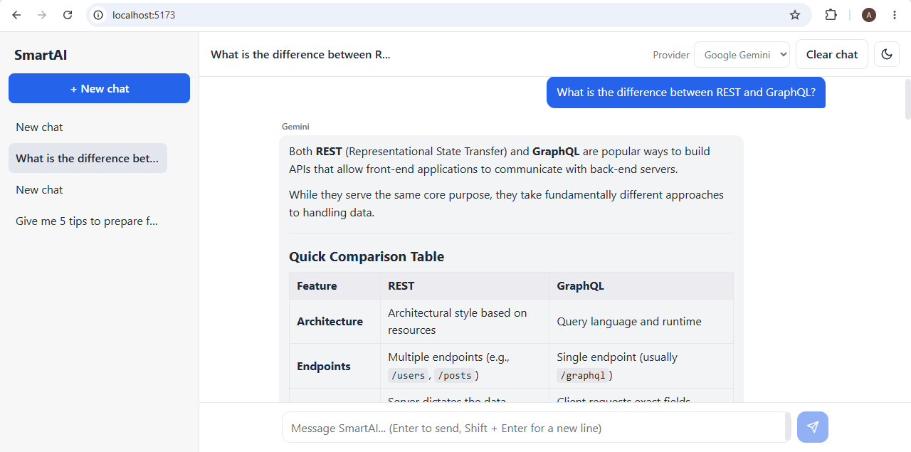
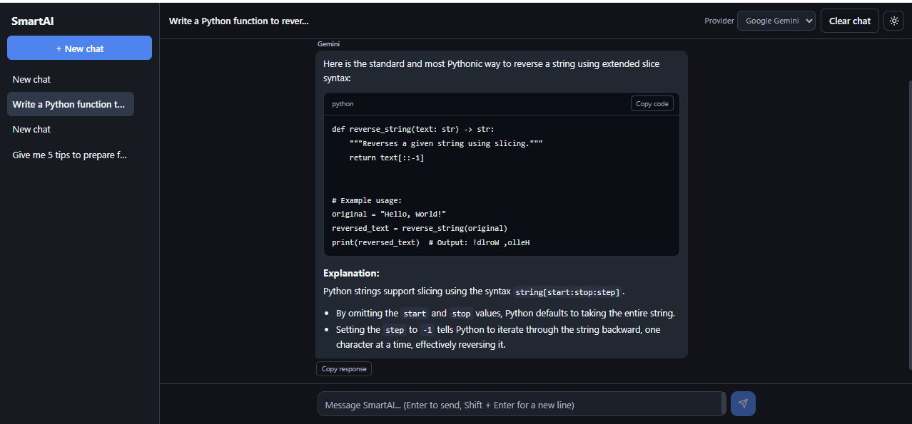
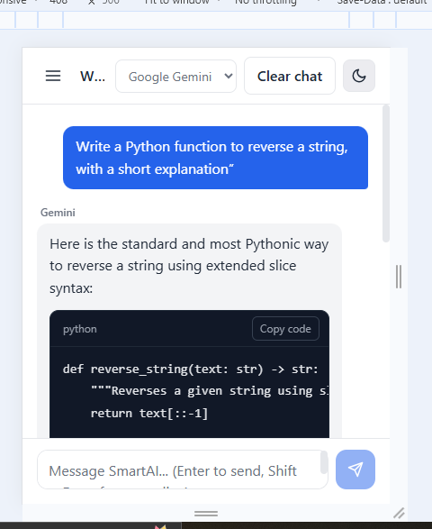
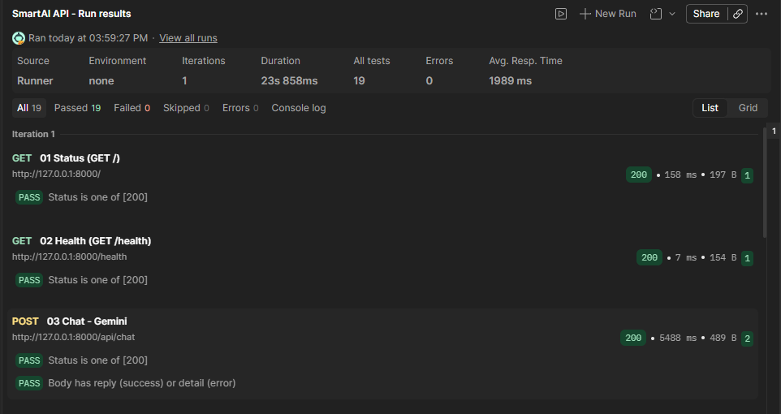

# SmartAI - AI Chatbot Web Application

SmartAI is a full-stack chatbot that talks to **OpenAI** and **Google Gemini** through a single FastAPI backend, with a clean, responsive React interface. It was built as a portfolio project to demonstrate AI API integration, REST API design, secure configuration, and frontend-backend communication.

## Features

**Chat**
- Ask questions and get AI answers, with user and AI messages shown as separate bubbles
- Loading animation while the AI is answering, auto-scroll to the newest message
- `Enter` sends a message, `Shift + Enter` adds a new line
- Readable error messages when something goes wrong (invalid key, quota, timeout, backend offline)

**Multiple AI providers**
- Switch between OpenAI and Google Gemini with a dropdown
- Both providers work through the same backend endpoint
- Each AI answer is labeled with the provider that wrote it

**Chat management**
- New chat, clear chat and delete chat
- Sidebar with chat history, saved in the browser (`localStorage`) so it survives a refresh
- No login or registration needed

**AI response formatting**
- Markdown rendering (headings, lists, tables, links)
- Code blocks with a language label and a **Copy code** button
- **Copy response** button on every AI answer

**Interface**
- Minimal, modern design with a consistent design system (CSS variables)
- Light and dark theme toggle, remembered between visits
- Responsive layout for desktop, tablet and mobile
- Welcome screen with example prompts

**Backend**
- Input validation, API timeouts, per-IP rate limiting
- API keys stay on the server and are never sent to the browser
- Safe error messages: internal details are logged on the server, not shown to users

## Tech Stack

| Layer | Technology |
|---|---|
| Frontend | React, Vite, JavaScript, HTML5, CSS3, react-markdown, remark-gfm |
| Backend | Python, FastAPI, Uvicorn, Pydantic |
| AI | OpenAI Python SDK (Responses API), Google Gen AI SDK (Gemini) |
| Tools | Git, GitHub, Postman, Visual Studio Code |

## How It Works

```
Browser (React + Vite)                    FastAPI backend                 AI providers
----------------------                    ---------------                 ------------
Chat UI, history in      -- POST /api/chat -->  validates request   --->  OpenAI Responses API
localStorage             <-- JSON reply -----   rate limit, timeout  --->  Google Gemini API
(no API keys here)                              API keys live in .env
```

The browser sends the selected provider and the conversation to `POST /api/chat`. The backend validates it, calls the chosen provider with the server-side API key, and returns the reply. The AI APIs are stateless, so the frontend sends the recent conversation (up to the last 20 messages) with every request.

## Project Structure

```
smartai/
├── backend/
│   ├── app/
│   │   ├── main.py              # FastAPI app, CORS, endpoints, error handlers
│   │   ├── config.py            # Settings loaded from environment variables
│   │   ├── schemas.py           # Request/response validation (Pydantic)
│   │   ├── rate_limit.py        # Per-IP rate limiter
│   │   └── services/
│   │       ├── openai_service.py   # OpenAI integration
│   │       ├── gemini_service.py   # Gemini integration
│   │       └── errors.py           # Safe, user-facing error type
│   ├── requirements.txt
│   └── .env.example
├── frontend/
│   ├── src/
│   │   ├── components/          # Sidebar, ChatWindow, MessageBubble, ChatInput, ...
│   │   ├── hooks/useTheme.js    # Light/dark theme
│   │   ├── services/api.js      # Calls the backend
│   │   ├── utils/               # localStorage and clipboard helpers
│   │   ├── styles/              # theme.css (design tokens), app.css
│   │   ├── App.jsx
│   │   └── main.jsx
│   ├── index.html
│   ├── package.json
│   └── .env.example
├── postman/SmartAI.postman_collection.json
├── docs/screenshots/
├── LICENSE
└── README.md
```

## Prerequisites

- Python 3.10 or newer
- Node.js 18 or newer (LTS recommended) and npm
- Git
- At least one API key: OpenAI and/or Google Gemini (see [API Configuration](#api-configuration))

## Installation

```bash
git clone https://github.com/Asifnawaz89-lab/smartai.git
cd smartai
```

### Backend

Windows (PowerShell):

```powershell
cd backend
python -m venv venv
.\venv\Scripts\Activate.ps1
pip install -r requirements.txt
Copy-Item .env.example .env
```

macOS / Linux:

```bash
cd backend
python3 -m venv venv
source venv/bin/activate
pip install -r requirements.txt
cp .env.example .env
```

Then open `backend/.env` and add your API key(s).

### Frontend

```bash
cd frontend
npm install
```

Optional: copy `frontend/.env.example` to `frontend/.env` if your backend is not running on `http://127.0.0.1:8000`.

## API Configuration

Edit `backend/.env`. Never commit this file (it is already in `.gitignore`).

| Variable | Description | Default |
|---|---|---|
| `OPENAI_API_KEY` | OpenAI API key | - |
| `OPENAI_MODEL` | OpenAI model name | see `.env.example` |
| `GEMINI_API_KEY` | Google Gemini API key | - |
| `GEMINI_MODEL` | Gemini model name | see `.env.example` |
| `FRONTEND_ORIGIN` | Allowed frontend origin(s) for CORS, comma-separated | `http://localhost:5173,http://127.0.0.1:5173` |
| `REQUEST_TIMEOUT_SECONDS` | Time limit for one AI request | `30` |
| `RATE_LIMIT_REQUESTS` | Max chat requests per window, per IP | `20` |
| `RATE_LIMIT_WINDOW_SECONDS` | Rate limit window | `60` |

Frontend (`frontend/.env`, optional): `VITE_API_URL` is the backend address. It is public, so never put secrets in frontend variables.

**Getting keys**
- OpenAI: create a key at [platform.openai.com](https://platform.openai.com). API usage needs billing credits; without them the app shows a clear "quota exceeded" message.
- Gemini: create a key in [Google AI Studio](https://aistudio.google.com/apikey). A free tier is available.

**Model names change over time.** If you see a "model was not found" error, set `OPENAI_MODEL` or `GEMINI_MODEL` to a model your account can use. To list the Gemini models available to your key (run inside `backend/` with the virtual environment active):

```bash
python -c "from app.config import get_settings; from google import genai; c = genai.Client(api_key=get_settings().gemini_api_key); [print(m.name) for m in c.models.list()]"
```

Remove the `models/` prefix when writing the name in `.env`. After editing `.env`, restart the backend.

## Running the App

Use two terminals.

**Terminal 1 - backend** (inside `backend/`, virtual environment active):

```bash
uvicorn app.main:app --reload
```

**Terminal 2 - frontend** (inside `frontend/`):

```bash
npm run dev
```

Open [http://localhost:5173](http://localhost:5173). Interactive API docs (Swagger UI) are at [http://127.0.0.1:8000/docs](http://127.0.0.1:8000/docs).

## API Reference

### `GET /`
Returns the backend status.

```json
{"app": "SmartAI API", "status": "running", "version": "1.0.0"}
```

### `GET /health`
Health check.

```json
{"status": "ok"}
```

### `POST /api/chat`
Sends a conversation to the selected provider.

Request:

```json
{
  "provider": "gemini",
  "messages": [
    {"role": "user", "content": "Explain artificial intelligence."}
  ]
}
```

- `provider`: `"openai"` or `"gemini"`
- `messages`: 1 to 50 messages; `role` is `"user"` or `"assistant"`; the last message must be from the user

Response:

```json
{
  "provider": "gemini",
  "reply": "Artificial intelligence is..."
}
```

Limits: a user message can have up to 8,000 characters, an earlier AI answer up to 32,000, and the whole conversation up to 60,000 characters.

Errors always return `{"detail": "<readable message>"}`:

| Status | Meaning |
|---|---|
| 400 | The provider could not process the request |
| 422 | Invalid request (empty message, unknown provider, last message not from the user, too long) |
| 429 | Rate limit exceeded, or the provider's quota is used up |
| 500 | Unexpected server error (details are only in the server log) |
| 502 | Provider rejected the key, model not found, or returned an unexpected error |
| 503 | API key not configured, or the provider cannot be reached |
| 504 | The provider took too long to respond |

## Testing

**Postman:** import `postman/SmartAI.postman_collection.json` and run the collection (11 requests with automated checks for success and error cases). The default `baseUrl` is `http://127.0.0.1:8000`.

**Frontend checks:**

```bash
cd frontend
npm run lint
npm run build
```

**Manual checklist:** backend and frontend start; OpenAI and Gemini replies; switching providers; empty messages rejected; API errors shown as readable messages; chat history survives a refresh; light/dark theme; mobile layout.

## Security Notes

- API keys are read from environment variables on the server only. They are never sent to the browser and never hardcoded.
- `.env` files are git-ignored; only `.env.example` files (without secrets) are committed.
- CORS only allows the origin(s) listed in `FRONTEND_ORIGIN`.
- All requests are validated (provider, roles, message and conversation size).
- Unexpected errors are logged on the server; users only see a generic message.
- Per-IP rate limiting and request timeouts protect against abuse and hanging requests.
- AI answers are rendered as Markdown with raw HTML disabled, and remote images are not loaded.
- Chat history is stored in the browser's `localStorage` (chat text only, never keys). Use "Delete chat" on shared computers.

## Production Deployment

**HTTPS.** Do not expose Uvicorn directly to the internet. Put it behind a reverse proxy that handles TLS certificates, or use a hosting platform that provides HTTPS. Caddy gets free certificates automatically:

```
api.example.com {
    reverse_proxy 127.0.0.1:8000
}

example.com {
    root * /var/www/smartai
    try_files {path} /index.html
    file_server
}
```

**Backend.** Run without `--reload`, and tell Uvicorn to trust the proxy so rate limiting sees real client IPs:

```bash
uvicorn app.main:app --host 127.0.0.1 --port 8000 --proxy-headers --forwarded-allow-ips="127.0.0.1"
```

**CORS.** Set the backend environment variable to your real site address, exactly (scheme and domain, no trailing slash, never `*`):

```
FRONTEND_ORIGIN=https://example.com
```

**Frontend.** Build with the public API address, then serve the `dist/` folder as static files:

```bash
VITE_API_URL=https://api.example.com npm run build
```

(On Windows PowerShell, set `$env:VITE_API_URL = "https://api.example.com"` first, then run `npm run build`.)

Set API keys as environment variables or secrets in your hosting platform, never in files in the repository.

## Screenshots









## Known Limitations

- OpenAI requests need an account with billing credits.
- Chat history is stored per browser; it is not synced between devices.
- The rate limiter is in-memory, so it works for a single server process. Use a shared store such as Redis when running multiple instances.
- Responses arrive all at once (no streaming yet).
- There are no user accounts.

## Future Improvements

- Streaming responses (Server-Sent Events) for a typing effect
- Stop-generation button and message regeneration
- Syntax highlighting inside code blocks
- User accounts and server-side chat storage
- Automated backend tests (pytest) and a CI pipeline with GitHub Actions
- Docker setup for one-command start
- Redis-based rate limiting
- Token usage display and more providers

## License

MIT License. See [LICENSE](LICENSE).

## Author

**Asif Nawaz**
GitHub: [github.com/Asifnawaz89-lab](https://github.com/Asifnawaz89-lab)